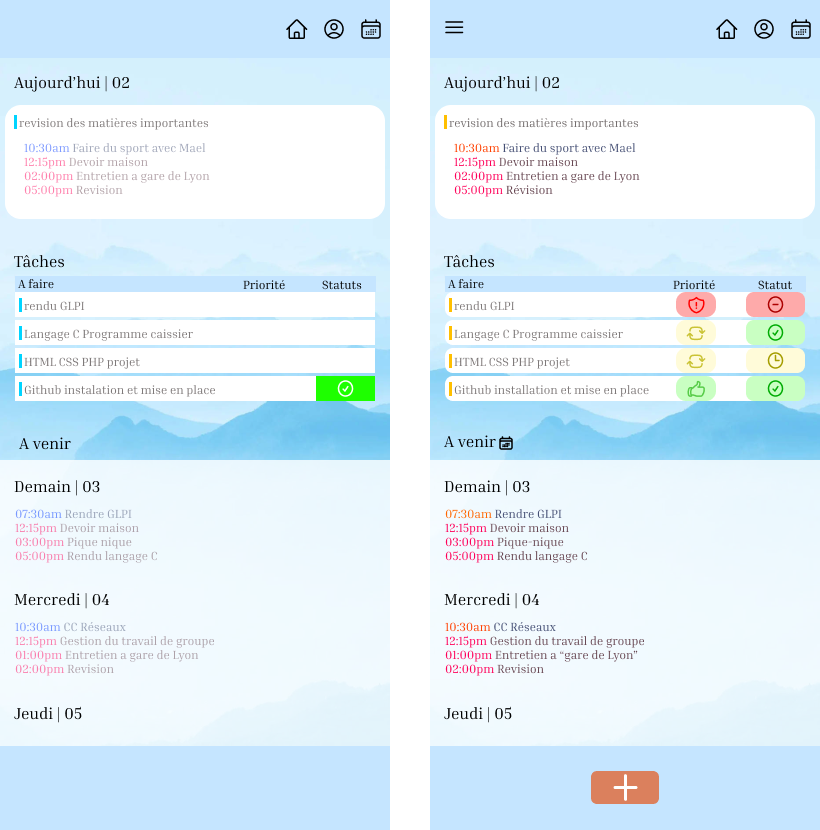

# Agenda étudiant · Maquette mobile (IHM)

Maquette d'une application mobile d'**agenda et de suivi de tâches** pour étudiants, conçue sur **Figma**.
Projet **individuel**, réalisé en contrôle continu du module IHM (Interfaces Homme-Machine), 1re année de Bachelor Informatique, ESGI Paris (2026).

## Avant / après

À gauche, la version rendue pendant le contrôle continu. À droite, la version que j'ai **retravaillée après la correction**.

## Ce que j'ai corrigé après le contrôle

| Problème de la version 1 | Correction apportée |
|---|---|
| Colonnes « Priorité » et « Statut » vides | Pictogrammes et **codes couleur** pour la priorité et l'état de chaque tâche |
| Une seule tâche avait un statut, en aplat vert vif | Statuts homogènes et lisibles (à faire, en cours, terminé) |
| Aucun moyen d'ajouter une tâche | Bouton **« + »** fixé en bas de l'écran |
| Pas d'accès au menu | Ajout d'un **menu burger** en haut à gauche |
| Fautes (« instalation », « Statuts ») | Orthographe corrigée |
| Horaires peu contrastés | Couleurs revues pour une meilleure lisibilité |

## L'écran

- **Aujourd'hui** : les rendez-vous de la journée avec leur horaire
- **Tâches** : liste des tâches avec priorité et statut
- **À venir** : planning des jours suivants
- Navigation : accueil, profil, calendrier

## Compétences mises en œuvre

- Conception d'interface mobile (format iPhone, 390 × 830)
- Hiérarchie visuelle, lisibilité, codes couleur
- Création de **composants réutilisables** sur Figma (badges d'état, boutons, icônes)
- Arborescence de l'application avant la maquette
- Prise en compte des retours pour améliorer une interface

## Fichiers Figma

- [Version rendue en contrôle continu](https://www.figma.com/design/FouvAAjBBuMLiu2BMAs3UB/)
- [Version corrigée](https://www.figma.com/design/o5ThEuQsl2wJbOVCrZv5wn/)
